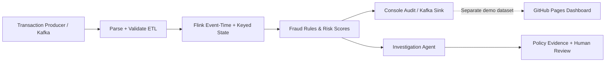

# BankGuard — Apache Flink Java Banking Fraud Detection & Investigation Agent

A GitHub-ready **Java 11 + Apache Flink 1.20.5** streaming project, plus a **standalone GitHub Pages dashboard** that works without backend infrastructure. All sample data is synthetic.

## Architecture



### Key capabilities
- **Ingestion:** synthetic Flink source by default; configurable Kafka source for live stream data.
- **ETL:** JSON deserialization and strict core-field validation. Invalid messages are rejected to job stderr (dead-letter sink is a production TODO).
- **Fraud engine:** 5-minute per-account velocity and spending, new device, country change, high value and high risk channels.
- **Stateful stream processing:** keyed Flink state, checkpointing and event-time watermarking. Simple example does not implement event-time timers or full late-event reconciliation.
- **Sinks:** JSON stdout audit and optional Kafka decision topic (at-least-once; downstream consumers must deduplicate by transactionId).
- **Investigation agent:** deterministic local policy retrieval and explainable recommendations, no external LLM required; **no automated enforcement**. The GitHub dashboard agent is an independent browser-side simulation.
- **Monitoring:** Apache Flink UI at port 8081; demo-mode dashboard displays **synthetic** KPIs, alerts and pipeline status (not live telemetry).
- **Deployment:** Maven + Docker Compose for Flink; GitHub Actions for Java CI and Pages deploy.

## View on GitHub Pages (no backend required)

**Where is `index.html`?** It is now at the repository root (`index.html`) for easy discovery and also in `docs/index.html` for the GitHub Actions Pages deployment. Both versions have their adjacent `app.js` and `styles.css` dependencies. GitHub Pages publishes the `docs/` version; keep the `docs/` copies when updating the live site.
1. Create a new **public** repository named `bankguard-flink-fraud` on GitHub.
2. Upload the **contents** of this folder to the repo root, including `.github/` and `docs/` (or use `git init`, add, commit, push).
3. Go to **Settings → Pages → Build and deployment → Source: GitHub Actions**.
4. Go to **Actions → Publish BankGuard GitHub Pages Demo → Run workflow**, if it has not started on push.
5. Visit `https://YOUR-USERNAME.github.io/bankguard-flink-fraud/` after the deployment succeeds.

**Important:** GitHub Pages hosts only static HTML/CSS/JavaScript. The dashboard uses synthetic browser data and will not start Flink or connect to your Kafka broker. Deploy the Java job separately for real streaming.

## Run actual streaming engine with Docker

```bash
docker compose up --build -d
# Open http://localhost:8081 to inspect Flink job
docker compose logs -f taskmanager
```

The `submit` service automatically submits the Flink job in synthetic mode. To stop:

```bash
docker compose down
```

## Run tests and build the Java artifact

```bash
mvn clean verify
# File produced: target/fraudstream-1.0.0-all.jar
```

## Kafka mode (optional)

```bash
docker compose -f docker-compose.yml -f docker-compose.kafka.yml up --build -d
```

Produce JSON events into Kafka topic `bank.transactions` using a Kafka producer connected to `localhost:19092`, e.g.:

```json
{"id":"TX-101","accountId":"ACC-1001","amount":6500.0,"merchant":"CRYPTO","country":"GB","deviceId":"ios-17","channel":"WIRE","currency":"USD","timestamp":1794180000000}
```

The output topic is `bank.fraud.decisions`. Ensure the input topic exists before sending. Kafka broker settings here are for local development only. If using cloud Kafka, configure credentials and TLS separately. See warning below about the local test timestamp; replace it with a current epoch millisecond value for meaningful event-time analysis.

## Important safety and production boundaries

**Demonstration only** — not safe for production payment blocking or making credit/customer decisions without validation, governance and legal review. Fraud rules are illustrative and uncalibrated. Browser agent is a demo; Java `InvestigationAgent` offers deterministic policy lookup (not actual vector embeddings, LLM inference, external knowledge retrieval, or live Kafka integration). For production, add secure customer data handling, authentication, RBAC, PCI/privacy controls, encryption, schema registry, replay/deduplication, audited review workflow, calibration and fairness monitoring, proper late-event strategies, a dead-letter topic, dashboard APIs, distributed metrics/tracing, idempotent output and tested disaster recovery. The example uses 5-minute transaction history and ignores adjustments for events outside this window. The simple account's last device/country uses arrival order, not guaranteed event time order.

## Project layout

```
.github/workflows/   GitHub Pages publish and Java CI
src/main/java/      Flink job, ingestion, validation, fraud rules, state and agent
src/test/java/      JUnit tests
docs/               GitHub Pages interactive dashboard
Dockerfile          Containerized Java Flink artifact
docker-compose.yml  Local jobmanager/taskmanager/job submit
docker-compose.kafka.yml  Optional local Kafka-compatible broker
```
